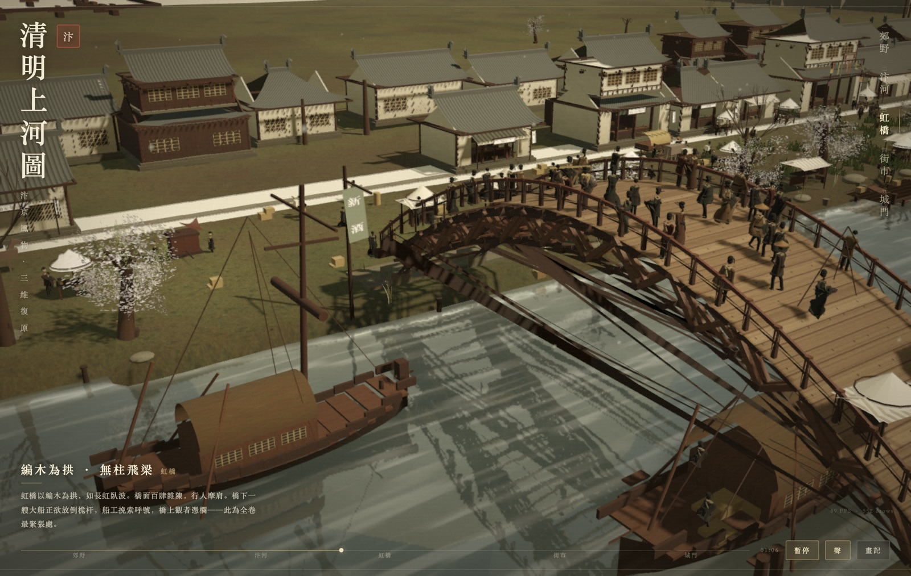
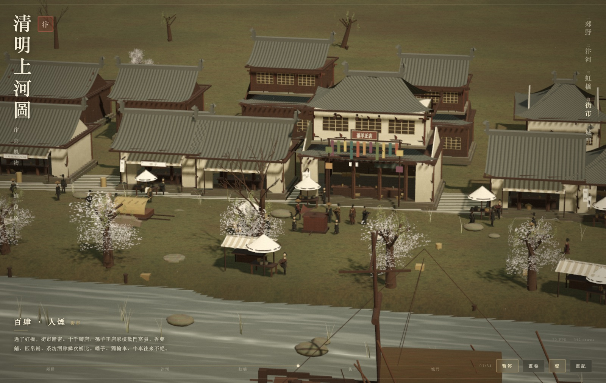
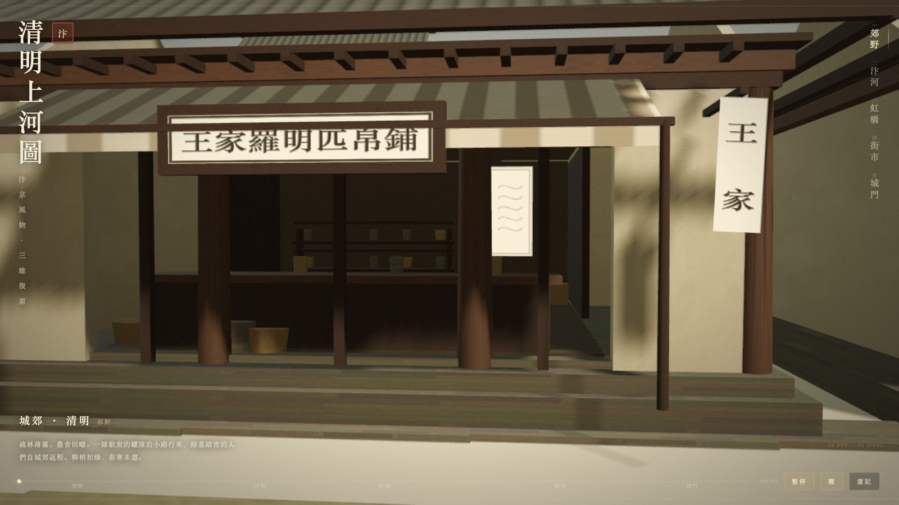
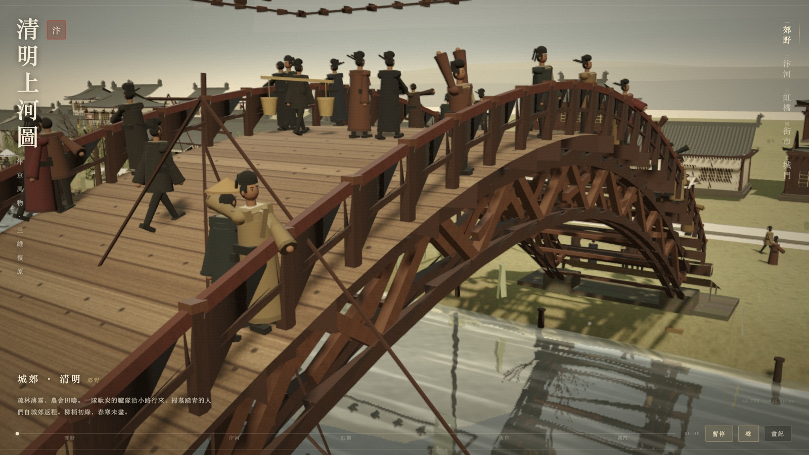
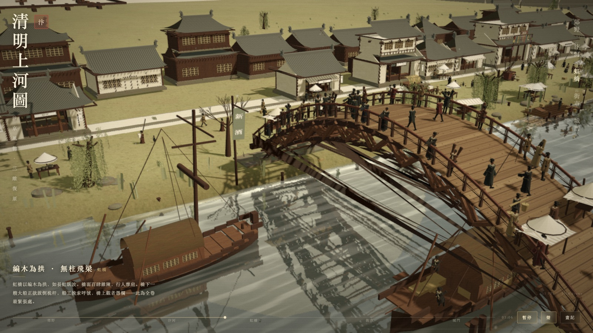
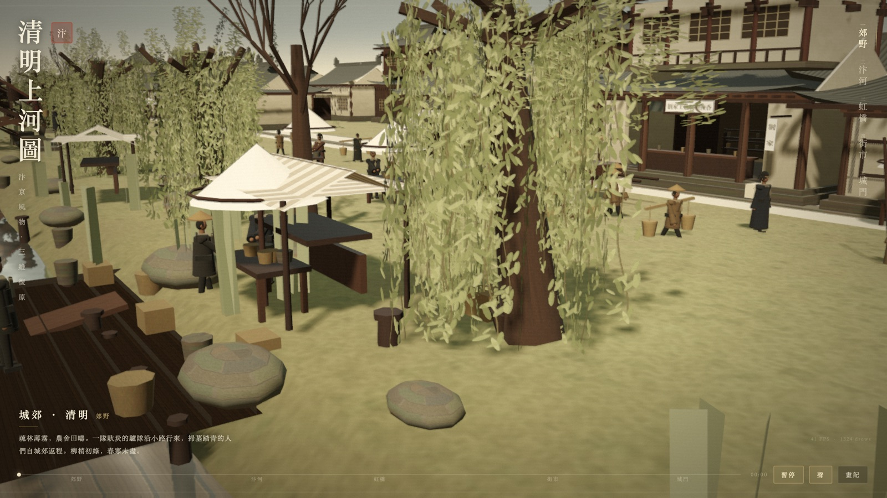
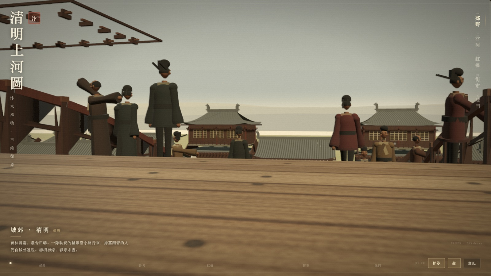
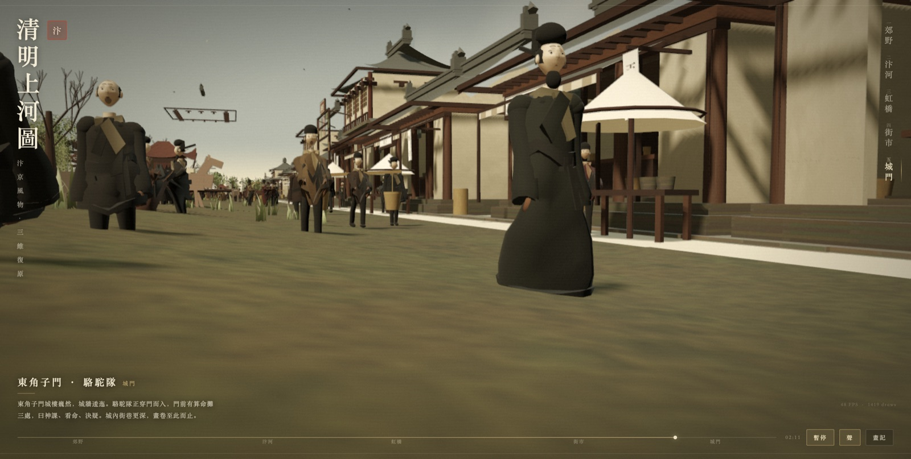

# 清明上河圖 · 汴京 — Three.js 三維復原

**構圖方向與原卷一致**：全場景沿 X 軸鏡像（`scene → worldRoot.scale.x = -1`），郊野在右、城門在左，巡遊自右向左展開；
所有牌匾/幌子的 Canvas 文字在繪製時預翻轉，鏡像後仍為正字。

以北宋張擇端《清明上河圖》長卷為藍本，用 Three.js 實時渲染的**可漫遊三維長卷**。
自城郊、汴河、虹橋一路到東角子門。過橋後街道緩緩內折（`streetZ` 增加 4.2 單位偏移），仿畫卷中街市漸次入城的走勢。
水面有動：12 艘船持續起伏橫搖、8 艘順流漂移（帶尾跡），10 隻鴨子在岸邊游弋。，全部模型、貼圖、聲音**程序化生成**，不依賴任何外部素材與網絡。

















## 打開方式

**方式一：直接雙擊 `index.html`**（純本地檔案，無需服務器、無需聯網）

**方式二：本地服務（推薦，字體與快取更穩）**

```bash
cd qingming
python3 -m http.server 8123
# 瀏覽器打開 http://127.0.0.1:8123/index.html
```

首次進入會加載約 8–12 秒（在瀏覽器裡即時營造整座汴京城），按下「展卷」入畫。

## 操作

| 操作 | 效果 |
| --- | --- |
| 拖動畫面 | 自由環視（會暫停巡游） |
| 滾輪 | 拉近／推遠 |
| 雙擊畫面 | 回到巡游 |
| 空格 | 暫停／繼續巡游 |
| ← / → | 前後捲動長卷 |
| M | 靜音切換 |
| 右側章節 | 郊野／汴河／虹橋／街市／城門 |
| 畫卷 | 切換「長焦手卷視角」（16° FOV、2.45 倍距離），壓縮透視，接近絹畫的散點透視構圖 |

底部進度條可點擊或拖動，直接跳到長卷任意位置。

## 長卷內容

自西向東，全長約 600 米的場景：

1. **郊野** — 田疇、農舍、茅頂草屋、柴垛、籬笆、稻草人；鄉路兩側榆柳桃李，一隊馱炭驢隊沿路行來，掃墓踏青的人自城郊返程。
2. **汴河** — 漕運命脈。八艘貨船、漁舟，船舷、拱形篷頂、桅杆、橫桁、櫓槳、繫纜樁；縴夫挽舟、腳夫卸糧，岸邊茶棚酒肆、蘆葦與繫船木樁。
   水面為**鏡像相機實時平面反射**：虹橋木拱、船身、岸樹倒映水中，漣漪擾動倒影；近岸有浪花白線與岸腳暗影。
   沿岸四座**木碼頭**（樁基、橫板、纜樁、貨堆、跳板、燈杆）、纜樁與貨堆成列，腳夫在碼頭上下貨。
3. **虹橋** — 編木拱橋，無柱飛梁，**斜跨汴河約 10°**（橋上行人/觀者/橋下大船均隨橋面斜向定位）；橋頭立**華表**（十字木表，畫中標誌物）：四道拱肋、交錯斜撐、橫向聯繫梁、木欄與紅欄杆、橋頭引橋石階。橋面百肆雜陳、行人摩肩；**橋下一艘大船正在放倒桅杆，船工挽索，橋上觀者憑欄**——全卷最緊張處。
4. **街市** — 店鋪鱗次櫛比、鋪面相連。十千腳店、孫羊正店（彩樓歡門、彩帛招子）、王家羅明匹帛鋪、劉家上色沉檀揀香、久住王員外家、趙太丞家；香藥鋪、茶坊、餅店、肉鋪、腳店。
   鋪面多為**敞開的木構店面**：深色店內、櫃台、後牆貨架與陶罐貨物、掛畫、門簾、門檻石；檐下**遮陽篷**自檐口挑出，簾邊懸招牌；閉門的牆面有深色木裙板（踢腳）、木框分間與窗框、門框構件；後排屋舍以木壁為主，拉開街景層次。
5. **城門** — 東角子門：夯土城台、磚砌門洞與半開門扇、城樓、女牆、兩翼城牆逶迤；門前神課、看命、決疑三處算命攤，駱駝隊正穿門而入。

### 人物與畜力
人物為**平滑車削／管狀幾何**：軀幹由 11 段輪廓車削（下擺、腰、胸、肩連續過渡，橫截面為橢圓），四肢為 10–12 邊的錐形管，肩部為球面三角肌、頸為錐管。
頭部是**局部雕刻的低模頭**（34×26 段）：球體先做下頜收分／下巴前推，再以 29 個徑向浮雕算子刻出（含上瞼褶、鼻翼、上下唇體、鼻唇溝、人中脊）**眼窩、上下眼瞼、鼻梁、鼻頭、鼻翼、人中、上下唇、口縫、顴骨、眉弓、太陽穴**，共用一份 945 頂點幾何；再裝**實體眼球**（鞏膜球＋虹膜＋瞳孔＋高光，四層同心）與**上下眼瞼殼**（球冠，隨眼型傾斜）；耳與頸的 UV 重映射到貼圖上的皮膚色板，與面部共用同一張貼圖與法線。貼圖繪製：512×256 等距柱狀貼圖，繪眼（鞏膜／虹膜／瞳孔／高光）、眉、鼻影與鼻翼、唇、髭鬚、兩頰紅暈、側面與額頭陰影；**1024×512** 貼圖另繪 2.4 萬個毛孔、900 顆雀斑與鼻翼/眼窩血色，，皮膚材質為 **MeshPhysicalMaterial**（sheen 0.55 + sheenColor 暖膚 + clearcoat 0.05）並注入 **rim 邊緣透光**，另有**面部法線貼圖**（鼻梁、眉弓、顴骨、唇部隆起），三款膚色／鬚型變體。
衣袍帶 **程序化布紋法線**（褶皺高度場）＋ **織紋貼圖** ＋ 逐頂點褶皺明暗（沿衣身正弦褶皺與高度漸變），非平塗；
冠帽分四式：**幞頭**（圓頂、後山、垂腳）、**展腳幞頭**（官員，兩翼橫出）、**幅巾**（結帶垂巾）、**斗笠**（笠圈、笠頂）。身形高矮、體型、面色略有差異。

動畫為骨架式分件擺動：四肢各自繞肩／髖擺動，手臂與腿反相，行走時上身前傾、身體起伏。
另有 **叉手、背手、抱物、倚立** 等站姿，挑夫擔筐、船工持篙、算命先生與顧客對坐。
全身為**單一蒙皮網格**：身、雙臂、雙腿合併為一份幾何（約 9,000 頂點），帶 `skinIndex/skinWeight`（依頂點到骨段的距離取前二骨加權），
綁定 **17 根骨骼**（hips→spine→chest→neck→head，每臂 shoulder→elbow→hand，每腿 thigh→knee→foot），
行走時由骨骼驅動大腿／小腿／肩／肘／髖／脊椎，頭與眼球掛在 head 骨上。
draw call 由每人 5 個網格降為 1 個蒙皮網格＋頭＋眼球。
**頭部 LOD 三檔**：12 m 內＝雕刻頭（34×26，含眼球眼瞼）；12–24 m＝簡化頭（14×10，無眼球）；24 m 外隱藏，露出體內的球頭。橋頭視角實測 247 人中僅 67 個頭參與繪製。
共 118 名街市行人 + 30 名橋上行人 + 憑欄觀者與攤販，約 200 人；驢、馬、駱駝、牛、豬，牛車、太平車、獨輪車、兩頂轎子。

### 視覺
- 依宋《營造法式》意匠建模：舉折曲面屋頂（懸山／廡殿）、正脊鴟吻、檐口連檐、椽頭、斗拱、露明木構、山花、腰檐、欄杆
- 全部貼圖由 Canvas 程序化繪製：瓦壟、木紋、灰泥、石板、夯土、窗棂、條紋布、牌匾文字
- **程序化法線貼圖**：由同一張高度貼圖生成（瓦壟、木紋、石縫、磚縫、木板、葉簇），隨光照產生凹凸，非平塗
- **樹冠 LOD**：每棵樹建兩套網格——42 m 內用實體葉簇、42–190 m 換成卡片簇；橋頭視角實測 101 棵樹中 1 棵用實體、48 棵用卡片
- **植被分層**：柳樹＝主幹＋分枝＋實體垂絲葉串（每串 7 段漸小葉簇）＋**實體小葉簇**（每簇 4 片折脊葉，帶 **葉脈貼圖 UV**、頂點色與微弱自發光近似透光，雙面、與葉片同光照，共 71 萬頂點合併為單網格）；枯樹枝梢綴實體小葉簇、松樹用松針簇、桃李用花簇
- **眉弓實體**：眼部網格內含三段加深眉弓幾何，不再只靠貼圖
- **地表**：土斑與苔痕**烘進地形頂點色**（多倍頻噪聲，無硬邊貼花），再由自訂 shader 按世界座標噪聲混合「草／土／苔」三張細節貼圖；地形網格 300×200
- **草與葦**：改為**真 3D 葉片**——每叢 5–7 片（葦 4–6 片），每片 5 段彎曲、沿高度錐度收尖、斷面呈 V 形折脊，頂點色由根部深綠漸變到葉尖淺綠；2200 叢草、240 叢葦，全部合併為單網格。
  **頂點風擺**以 uv.y（0 根→1 梢）為權重，法線向天光傾斜，雙面渲染
- **草層 LOD**：3000 叢草 + 2200 張補白卡，按 40×40 分塊（108 塊）。38 m 內繪 3D 葉片；7–150 m 由 **alpha 三變體圖集 billboard 卡**（768×256，每張 60+ 葉）接手，7–16 m 抖動進場、116–150 m 淡出；
  卡片用 **MeshStandardMaterial + 注入 billboard**，接受與葉片相同的太陽光、IBL 與場景霧（不再是自發光色塊）；分佈按 fbm 噪聲成片。
  兩層都用**屏幕抖動（dither）**按距離淡入淡出（葉片 46→60 m、卡片 42→58 m 進場），過渡無硬切
- **頂點 AO**：合併幾何時按高度與法線朝向烘焙遮蔽（貼地壓暗、朝下壓暗），牆腳、檐下、樑底自然變深
- **IBL 環境光**：以天穹 + 地面色生成 PMREM 環境貼圖，PBR 材質獲得柔和環境反射
- 材質按 PBR 分級：木 0.70–0.82 粗糙、瓦 0.86、灰泥 0.95、石 0.88、金屬 0.38/0.8
- 水面：半分辨率鏡像相機平面反射（隔幀更新）＋菲涅爾混合＋漣漪擾動＋日光碎金
- 後期：絹本暖調、墨線輪廓、紙紋與纖維、暗角，逐格還原絹畫質感
- 柳絮浮塵、飛鳥盤旋、水波、船影、帆幌隨風

### 聲音（全部實時合成，無音頻檔案）
- 汴河水聲、拍岸、市井人聲（五路帶通噪聲 + 音節調制）
- 鳥鳴、遠處鐘磬
- 古琴散音（諧波撥弦合成）+ 洞簫氣聲，五聲音階散板；卷軸式混響

## 技術

```
index.html          界面 / 開場 / 章節 / 進度
vendor/three.min.js three.js r149（本地）
src/util.js         隨機、噪聲、幾何合併、頂點色、Canvas 貼圖
src/materials.js    程序化材質與燈光
src/world.js        地形、汴河水面（GLSL）、街市、遠山、田野
src/buildings.js    屋頂曲面、屋舍、店鋪、彩樓、城門
src/bridge.js       虹橋
src/nature.js       柳、枯枝、松、桃、草、柳絮、飛鳥
src/life.js         人物、牲畜、車、船、行走系統
src/town.js         街市布局與地標
src/audio.js        WebAudio 聲音合成
src/main.js         渲染、後期、巡游相機、交互
```

- 場景按材質合併幾何（`QM.Bag`、`mergeGeoms`），全場約 250–400 draw call
- 人物用頂點色單網格 + 兩條腿骨骼式擺動，控制 draw call
- 陰影貼圖跟隨視點，2048×2048
- 自研環視控制器、後期 Shader，不依賴 examples/jsm
- 幀內耗時（bridge close-up 實測）：反射 1.07 ms、主通道 8.17 ms、後期 0.03 ms → 約 9.3 ms/幀（96–107 FPS）

瀏覽器要求：支援 WebGL2 的現代瀏覽器（Chrome / Edge / Safari 16+ / Firefox）。

## 說明

此為**藝術性復原**，非考古測繪：建築比例、街巷尺度依據畫面意匠與宋代營造常識推演，非嚴格復原。畫面中的文字招牌取自畫中可見者與同期市肆名目。
